# MyTaskV

GAS (Google Apps Script) + Google Sheets で動作する、カンバンタスク管理アプリケーションです。
**データ保存はスプレッドシートでシンプルに、見た目は分かりやすく扱いやすいWebアプリにする** というアプローチで、生成AIと壁打ちして作成しました。

Webアプリの画面とスプレッドシート(データ)の画面
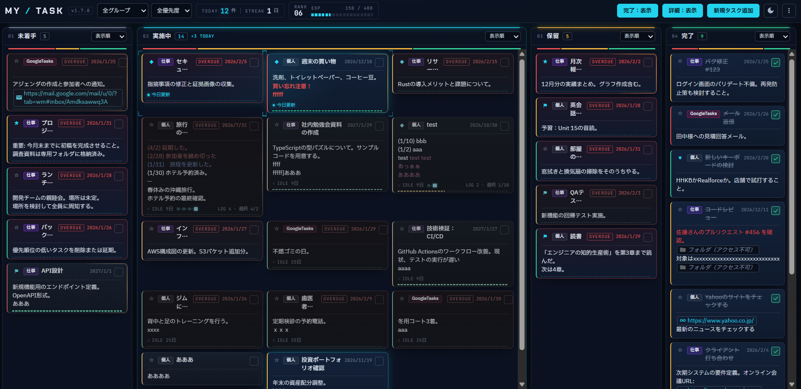
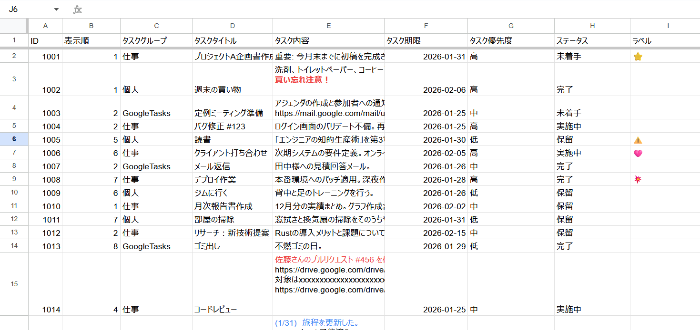

## 更新履歴

> v1.7.0 より、リポジトリを [MyTask](https://github.com/blueshooterX/MyTask) から本リポジトリ (MyTaskV) へ移行しました。

### v1.7.0

- UIをSF調デザインに全面刷新し、テーマ切替（自動 / ライト / ダーク）を追加
- HUD（RANK / EXP / 本日の目標 / 実績 / CHAIN）を追加
- 演出24種と「演出設定」パネルを追加（俯瞰モード・重力モード・起動シーケンス・効果音など）
- ラベルを単色記号（☆ ★ ⚑ ◆ ♥）に変更
- ドラッグ＆ドロップを自前実装に置き換え（Sortable.js を廃止）

### v1.6.0

- タスクに「最終更新日時」列を追加（既存シートは自動でヘッダーを追加）
- 操作履歴を記録する `ActivityLog` シートを追加
- カードの鮮度表示、「最近更新」ソート、進捗ドット、列ヘッダーの優先度ミニバーを追加
- アクティビティパネル（TODAY / STREAK、26週ヒートマップ、週次ふりかえり）を追加
- Google Drive の URL をファイル名付きのリンクチップで表示

### v1.5.0

- データ更新タイミングを改善

### v1.3.1

- タスク編集時にUI反映を先行し、スプレッドシートに後で書き込む方式に変更
- ドラッグアンドドロップ時にテキスト選択を抑止
- ESCキーでタスク編集モードを解除する機能を追加
- ライセンス表示を改善

### v1.3.0

- 公開初版

## Features

- **完全無料 & プライベート**: データは全てあなたの Google Drive (スプレッドシート) に保存されます。
- **カンバンボード**: 「未着手 / 実施中 / 保留 / 完了」の4列。ドラッグ＆ドロップで並べ替え・ステータス変更し、保存バナーから一括保存します。
  - カラム幅のドラッグリサイズ、グループ・優先度での絞り込み、カラムごとのソート（表示順 / 優先度 / グループ / 期限 / 最近更新）
  - 「完了」「詳細」の表示・非表示トグル
- **カード操作**: ✓ボタンで完了 / 差し戻し、ラベル記号をクリックで切替。期限ゲージ・期限超過表示、更新の鮮度表示（実施中で7日以上更新がないと IDLE 表示）、本文の `(M/D)` 行から進捗ドットを表示します。
- **リッチテキスト同期**: 太字・取り消し線・文字色・箇条書きが、Webアプリとスプレッドシート間で同期されます。
- **Drive リンクチップ**: ドキュメント・スプレッドシート・スライド・フォルダ等の URL を、種類アイコンとファイル名で表示します。
- **アクティビティ**: 本日の更新数と連続日数（STREAK）、26週分のヒートマップ、週次ふりかえり（今週の件数・前週比・よく触ったタスク）を表示します。
- **HUD**: 操作履歴から RANK / EXP を算出し、本日の目標・実績・連続操作（CHAIN）を表示します。
- **演出 & テーマ**: 24種の演出を「演出設定」パネルで個別に ON/OFF できます。テーマは自動（OSに従う）/ ライト / ダークを切り替えられます。OSで「視差効果を減らす」が有効な場合、演出は初期状態で OFF になります。
- **Google Tasks 連携**: Google Tasks の未完了タスクを一括インポート（同じタイトルのタスクはスキップ）。
- **アクセス制御**: `AccessControl` シートに登録したメールアドレスのユーザーのみ利用できます。

### キーボード操作

| キー | 動作 |
| --- | --- |
| `Esc` | モーダル・パネルを閉じる / 俯瞰モード・重力モードを終了 |
| `g` を素早く3回 | 重力モードの開始 / 終了 |

## Requirement

- Google アカウント
- Google Chrome (推奨)

## Installation

### 1. スプレッドシートの準備
1. 新規スプレッドシートを作成します。
2. デフォルトのシート名を `AccessControl` に変更します。
3. A列に、アプリへのアクセスを許可するメールアドレスを入力します（ヘッダー行は不要です）。
   - `A1: xxxxx@yyy.zzz`

   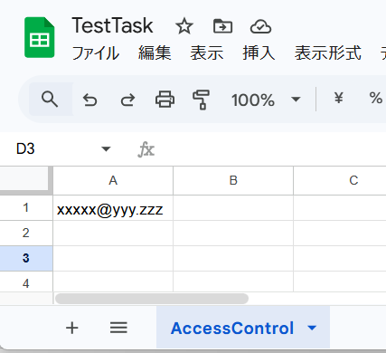
4. スプレッドシートの ID (URLの `/d/` と `/edit` の間の文字列) を控えておきます。
   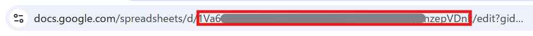

> **Note**: `TaskList` シートと `ActivityLog` シートはアプリの利用時に自動生成されます。

> **Warning**: `AccessControl` シートが存在しない場合、アクセス制御は行われず誰でも利用できる状態になります。

#### シート構成

| シート | 作成 | 内容 |
| --- | --- | --- |
| `AccessControl` | 手動 | A列: 利用を許可するメールアドレス |
| `TaskList` | 自動 | A:ID / B:表示順 / C:タスクグループ / D:タスクタイトル / E:タスク内容 / F:タスク期限 / G:タスク優先度 / H:ステータス / I:ラベル / J:最終更新日時 |
| `ActivityLog` | 自動 | 日時 / タスクID / 種別 (create / update / complete / reopen / move) / タスクタイトル |

### 2. GASプロジェクトの作成

※ `clasp`の利用ができる方は、末尾のデプロイ手順を参考にしてください。

1. Google Drive で「Google Apps Script」プロジェクトを新規作成します。
   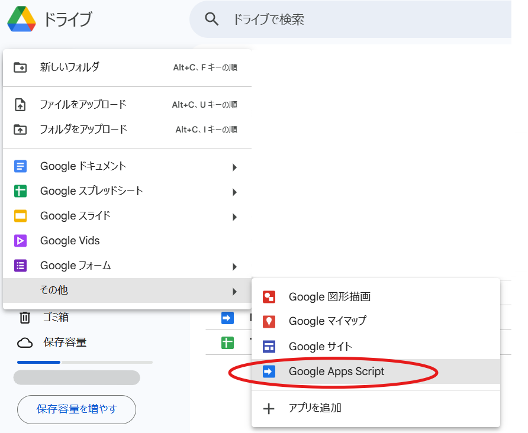
2. 本リポジトリの `dist` フォルダ内にある以下のファイルをプロジェクトに追加・上書きします（dist内のファイルの生成は末尾のBuild & Bundleを参照）。
   - `Code.gs` (GASエディタ上の `コード.gs`)
      - `dist`フォルダ内の`Code.gs`の内容を貼り付けてください。
   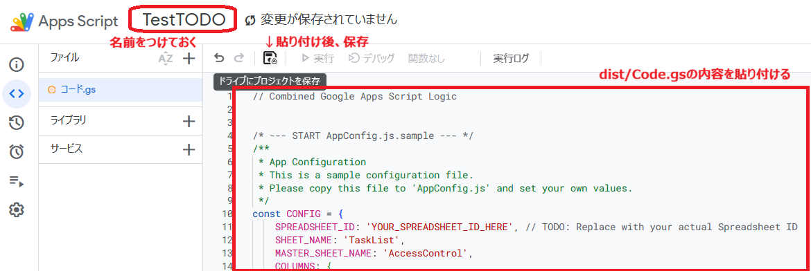
   - `index.html`
      - ファイルの横の＋を押してHTMLを選択します。
      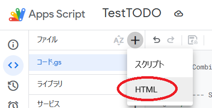
      - ファイル名を"index"にしてください。
      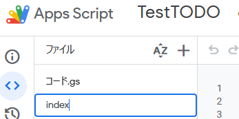
      - `dist`フォルダ内の`index.html`の内容を貼り付けてください。
      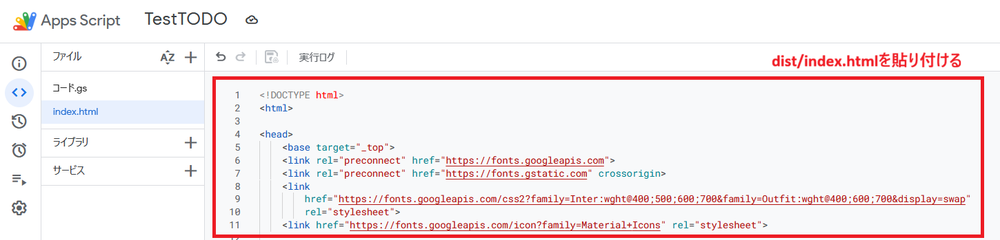
3. リポジトリのルートディレクトリにある`appsscript.json`の内容を設定
   - プロジェクト設定から「appsscript.json マニフェストファイルをエディタで表示する」にチェックを入れます。
   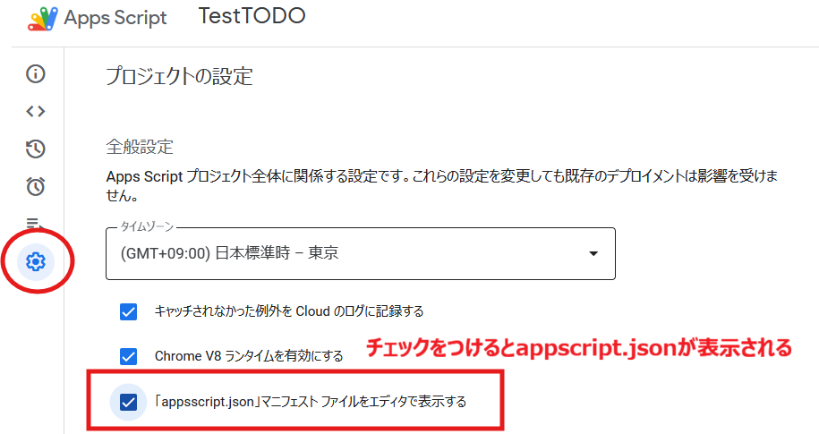
   - ファイルに`appsscript.json`が表示されているので、その内容を全て書き換える形で上書きします。
   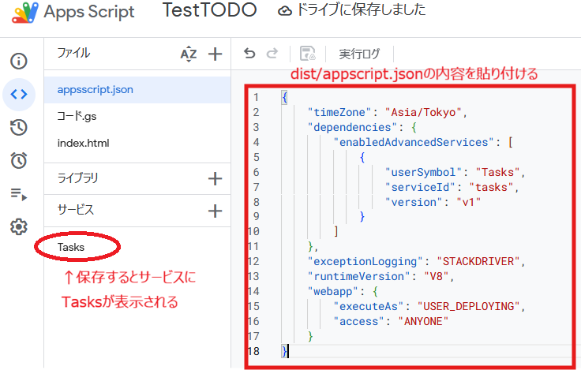

### 3. 設定ファイルの更新
1. ファイルを個別に登録した場合は、`AppConfig.js.sample` を `AppConfig.js` にリネームします。(※`コード.gs`へ直接貼り付けた場合は不要です)
2. `SPREADSHEET_ID` を手順1で控えたIDに書き換えます。
　(コード.gsの最初の方にあります。AppConfig.jsも同様です。)

```javascript
const CONFIG = {
    SPREADSHEET_ID: 'YOUR_SPREADSHEET_ID_HERE', 
    // ...
```
   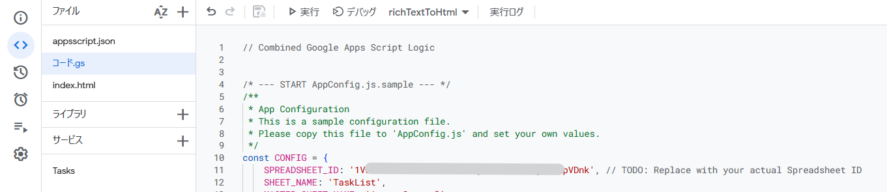

### 4. デプロイ
1. GASエディタ右上の「デプロイ」→「新しいデプロイ」を選択。
   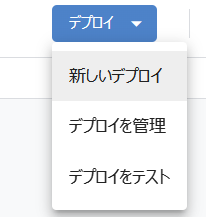
2. 種類: 「ウェブアプリ」。
   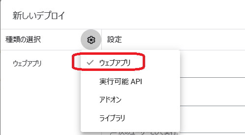
3. 次のユーザーとして実行: 「自分」。
4. アクセスできるユーザー: 「全員」または「自分のみ」。
   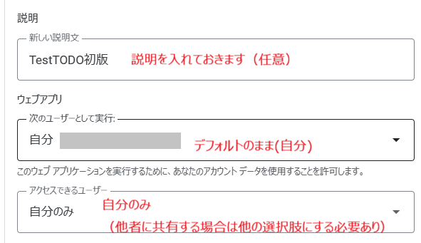
5. 権限の許可
   - 以下の画面が表示されたら、「アクセスを承認する」を押して許可する。
   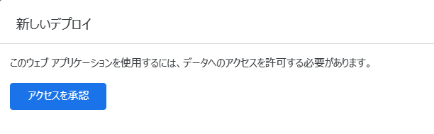
   - 「Advanced」を押す。
   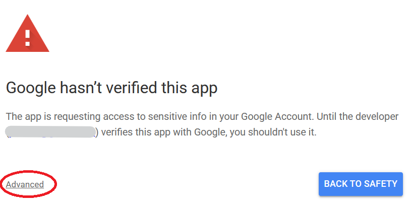
   - 「Go to <設定した名称> (unsafe)」を押す。
   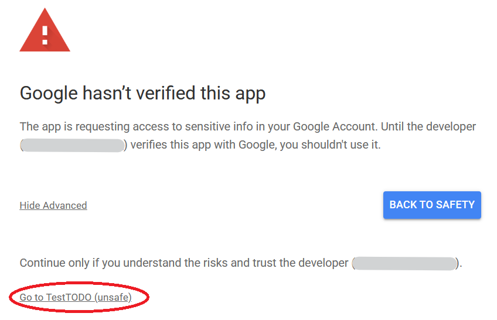
   - 以下のアクセス権限の許可を確認されるので、「Select all」にチェックを入れ （または個別にチェック）「Continue」を押す。
     - Google スプレッドシート
     - Google Tasks
     - Google Drive（読み取り専用。リンクチップのファイル名取得に使用）
     - メールアドレスの取得（アクセス制御に使用）
   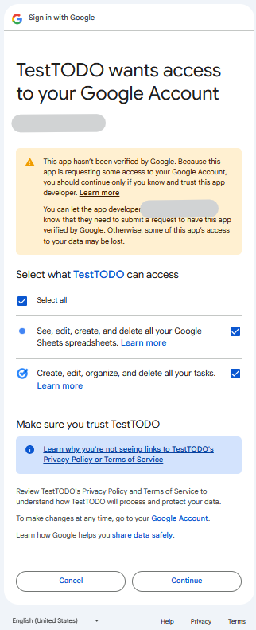
6. 発行されたウェブアプリURLにアクセス！
   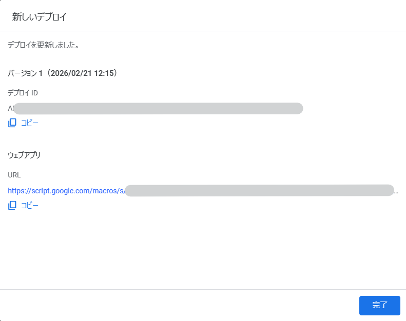

> **Note**: v1.5.0 以前から更新する場合、Google Drive の権限が追加されているため、再デプロイ後に再度権限の承認が必要です。

> **Note**: 「全員」に公開した場合でも、Google Workspace のドメイン外のユーザーはメールアドレスを取得できず、アクセス制御で拒否されることがあります。

## Development(claspによるデプロイ)

開発者向けの手順です。

### Prerequisites
- Node.js
- clasp (`npm install -g @google/clasp`)

### Setup
```bash
# Clone repository
git clone https://github.com/blueshooterX/MyTaskV.git
cd MyTaskV

# Create config file (AppConfig.js is git-ignored)
cp AppConfig.js.sample AppConfig.js
# -> AppConfig.js の SPREADSHEET_ID を書き換える

# Login to Google
clasp login

# Create new GAS project (or clone existing)
clasp create --type webapp --title "MyTaskV"
# OR
clasp clone <scriptId>
```

`.clasp.json` は git 管理外のため、`clasp create` / `clasp clone` で各自生成してください。

### Deploy (clasp)
```bash
# Push Code
clasp push

# Deploy
clasp deploy
```
## Development(GASエディタによるデプロイ)

### Prerequisites
- Node.js

### Build & Bundle

複数のソースファイルを1つの `Code.gs` と `index.html` にまとめます。

```bash
node bundler.js
```
生成された `dist/` 配下のファイルをGASエディタへ貼り付けてください。

- `dist/Code.gs` には `AppConfig.js.sample` の内容が取り込まれるため、`SPREADSHEET_ID` は貼り付け後に書き換えてください。
- `appsscript.json` は bundler の対象外です。リポジトリの `appsscript.json` を別途貼り付けてください。


## License

MIT License
